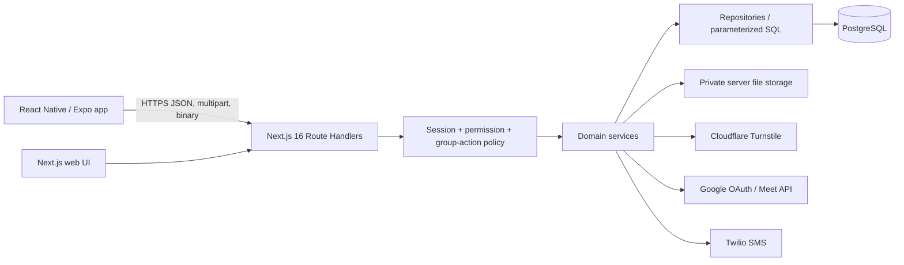

# System architecture

## Current implementation

| Concern | Implementation |
|---|---|
| Framework | Next.js `^16.0.0`, React `^19.2.0` |
| Routing | App Router only (`src/app`); no `pages` directory/API routes found |
| Language | JavaScript ES modules (`"type": "module"`), not TypeScript |
| API style | Next.js Route Handlers using Web Request/Response and `NextResponse` |
| Database | PostgreSQL through `pg.Pool`; parameterized SQL; no ORM/query builder |
| Validation | Zod 4 schemas and a shared `parse()` adapter |
| Layers | route → auth/authorization → service → repository/SQL → PostgreSQL |
| Transactions | explicit PostgreSQL transactions for mutations |
| Authentication | custom opaque session token, hashed in `user_sessions`, cookie transport |
| Authorization | permission codes plus organization/project/state/group scope and contextual group actions |
| Audit | append-only `audit_logs`; secret-looking fields removed from old/new JSON |
| Files | server-local private filesystem abstraction; metadata in PostgreSQL |
| Notifications | in-app rows plus server-side Twilio meeting-summary outbox; no push |
| External services | Cloudflare Turnstile, Google OAuth/Meet, Twilio SMS, Botpress web chat |

The installed Next.js 16 documentation confirms Route Handlers are the App Router API primitive and that `cookies()` is asynchronous. The code follows those conventions.



**MOBILE APP MUST NOT CONNECT DIRECTLY TO POSTGRESQL.**

## Request and response architecture

Most JSON APIs return one of:

```json
{"success":true,"data":{}}
```

```json
{"success":false,"error":{"code":"VALIDATION_ERROR","message":"Invalid request","details":{}}}
```

Binary download endpoints return PDF or XLSX directly and therefore do not use the JSON success wrapper. Google OAuth connect/callback endpoints redirect and are web-only in their current form. Health returns `{ "status": "ok" }` without the shared wrapper.

## Authentication and protection

`requireSessionUser()` permits a forced-password-change session. `requireAuth()` additionally rejects `must_change_password=true`. Protected pages perform equivalent redirects in `src/app/(protected)/layout.js`. Every protected route handler observed calls one of these guards. Authorization is not centralized in a middleware/proxy; it is close to each route/service.

Group actions are more specific than permission codes. `requireGroupRouteAction()` resolves organization, group, operating mode, active/current cycle, linked member, cycle membership, current officer assignment, facilitator assignment/status/scope, and program scope. A route may require both a permission code and contextual action; current digital officers are admitted through the contextual policy.

Sources: `src/lib/auth/session.js`, `src/lib/permissions/**`, `src/modules/group-access/**`, `src/app/(protected)/layout.js`.

## Database and data integrity

The application uses PostgreSQL constraints, composite foreign keys, unique indexes, ledger accounts/entries, row locks, and explicit transactions. Financial mutations create immutable domain/ledger records and use reversal records rather than editing posted money. Selected high-risk mutations use caller-provided idempotency keys and request fingerprints.

The pool is process-global in development and configured with max 20 connections, 30-second idle timeout, and 5-second connection timeout. `DATABASE_URL` is server-only.

Sources: `src/lib/db/pool.js`, `src/lib/db/transaction.js`, `database/migrations/016_phase_2b_meetings_ledger.sql`, `src/modules/meetings/financial.service.js`.

## Audit and notifications

Audit events store actor, action, entity, sanitized old/new values, IP, and user-agent when supplied. Keys matching `password|secret|token` are removed recursively. This reduces but does not eliminate the need to avoid passing sensitive or PII-heavy objects to audit.

In-app notifications are recipient-scoped rows, listed newest-first with a maximum of 100. Meeting close creates SMS outbox records inside the close transaction, then performs Twilio trial processing after commit. Provider failure does not reopen the meeting.

Sources: `src/lib/audit/audit.service.js`, `src/modules/notifications/**`, `database/migrations/029_notifications.sql`, `database/migrations/054_meeting_sms_notifications.sql`.

## File storage

Constitution PDFs and reconciliation PNG signatures are stored under a server-private root (`VSLA_PRIVATE_UPLOAD_ROOT`, or an OS temp fallback in nonconfigured environments). Metadata and hashes are stored in PostgreSQL. There is no S3/object-store adapter in the current code. Server-local storage durability and multi-instance sharing are **NEEDS CONFIRMATION** for staging/production.

Sources: `src/lib/private-storage.js`, `src/modules/onboarding/constitution-document.service.js`, `database/migrations/034_operational_integrity_documents.sql`.

## Networking readiness

**NATIVE NETWORKING READINESS: PARTIAL.**

- All primary APIs use HTTPS-compatible JSON/FormData/binary contracts and relative web URLs do not leak into server API responses except Google redirect flows.
- No explicit CORS headers or OPTIONS handlers were found. Native React Native traffic is not governed by browser CORS, but web views and browser-based clients are.
- No explicit Origin/Referer validation or CSRF-token framework was found. Cookie `SameSite=Lax`, HTTPS, and same-origin web usage are the current posture.
- The auth transport is cookie-only and native persistence is unproven.
- `Secure` is enabled only when `NODE_ENV=production`; staging deployment mode must be confirmed.
- Google connect/callback assumes browser redirects and is not a member-mobile requirement.

Sources: `next.config.mjs`, `src/lib/auth/session.js`, `src/app/api/v1/integrations/google/**`.

## Known risks / inconsistencies

- The historic seed file includes legacy `MEMBER`/`GROUP_OFFICER`, while the current bootstrap and runtime use `VSLA_MEMBER` plus dynamic officer assignments. Use `database/bootstrap/001_rbac.sql` and current migrations, not the old seed alone.
- Several route files import `requirePermission` but delegate to `requireGroupRouteAction`; the imports may be unused. The action policy is still enforced.
- The web dashboard has no JSON route; mobile must compose member APIs or wait for a dashboard API.
- Server-local private storage may not survive or synchronize across horizontally scaled hosts.
