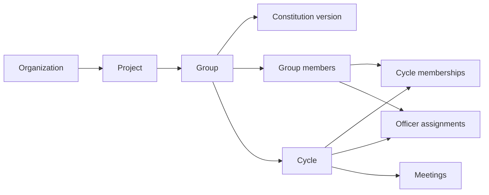
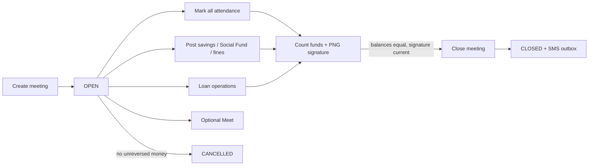
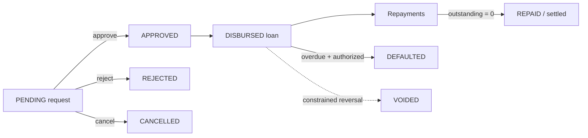

# Business workflows

## Member identity and self-service

`users` are login accounts. `group_members` are people enrolled in a specific group. They are linked only when `group_members.linked_user_id = users.id`; not every member has a login. `cycle_memberships` then says whether that member participates in a particular cycle and from which effective date.

Digital Access either creates a new `VSLA_MEMBER` user (forced password change) or links an existing active user. Self-service endpoints derive the member from the session user; the client does not send its own member ID.

```text
authenticated user
  → organization-scoped group_members.linked_user_id
  → cycle_membership for requested/current cycle
  → personal activity and meeting attendance snapshot
```

Never replace `/api/v1/me/**` with generic member endpoints plus a locally stored `memberId`.

## Group and cycle lifecycle



Group statuses: `DRAFT`, `ONBOARDING`, `ACTIVE`, `SUSPENDED`, `CLOSED`, `ARCHIVED`.

Cycle statuses: `DRAFT`, `READY`, `ACTIVE`, `CLOSING`, `CLOSED`, `CANCELLED`. A new cycle is at most 12 months. Activation requires approved constitution, participants, all five active officer positions, and—after cycle 1—a closed prior cycle with completed share-out and disposed Social Fund.

Cycle membership has `participation_start_date` and optional end date. A meeting snapshot only includes participants effective on its date. Late admission to an active cycle is explicit and cannot silently rewrite older meetings. Removing an active-cycle participant is not supported; READY-cycle removal is blocked when the member has an officer assignment.

Sources: `src/modules/onboarding/onboarding.service.js`, `src/modules/cycle-participation/cycle-participation.service.js`, migration `039_cycle_member_participation.sql`.

## Meeting workflow



Creation requirements:

- active group and active cycle with approved constitution;
- meeting date inside the cycle, not future in Africa/Lagos, not before prior closed meeting;
- no other open meeting;
- mode Physical/Virtual/Hybrid; nonphysical manual link must be a valid Google Meet URL; automatic creation is best-effort after meeting creation.

On creation, the server snapshots all cycle participants effective on the meeting date into attendance with `UNMARKED`. Financial writes require an OPEN meeting, ACTIVE group/cycle, and an eligible member in that snapshot.

Close requirements:

- actor passes the special meeting-close policy;
- meeting is OPEN;
- no `UNMARKED` attendance;
- a signed reconciliation exists;
- latest reconciliation is `BALANCED` and still matches current ledger balances.

Close commits the meeting and SMS outbox first. Google conference end and Twilio processing happen after commit; their failures are warnings/operational review, not a rollback of the close.

Cancellation requires OPEN and no unreversed financial transactions.

## Savings, Social Fund, and fines

Savings request supplies number of shares; server reads constitution share value, enforces per-meeting min/max, and calculates amount. Social Fund request supplies no amount; server reads constitution contribution. Fine request supplies a constitution fine-rule ID; server reads its amount. All three require an idempotency key and immutable ledger/domain writes.

One active savings purchase and one active Social Fund contribution per member/meeting are permitted. Correct mistakes by reversal during the open meeting, not edit/delete.

**THE MOBILE CLIENT MUST NOT IMPLEMENT ITS OWN AUTHORITATIVE FINANCIAL LOGIC.** It may format server values for display, but server calculations and returned balances win.

## Loan workflow



Request rules:

- OPEN meeting in active group/cycle;
- borrower has effective cycle participation and is in meeting snapshot;
- attendance is exactly `PRESENT`;
- no outstanding loan or unresolved request in the cycle;
- requested principal ≤ server-calculated maximum based on net savings and constitution multiple;
- term ≤ constitution maximum;
- ordinary-member self-request derives borrower from the linked member and rejects substitution.

Decision rules:

- request must be PENDING and in the same organization/group/cycle as meeting;
- approval cannot exceed requested principal, current eligibility, or max term;
- SOD rules apply; decision produces immutable `loan_decisions` and updates request status.

Disbursement rules:

- approved request; eligibility rechecked; no outstanding loan;
- sufficient Savings/Loan cash;
- SOD rules apply;
- idempotency key required;
- server calculates service charge, contractual total, and due date; creates ledger and loan.

Repayment allocates service charge first, then principal; it cannot exceed outstanding. Full payment sets `settled_at`. Repayment is idempotent. Only an overdue projected loan may be marked defaulted. Reversals require the original open meeting; only the latest active repayment can be reversed; disbursement cannot be reversed after an active repayment.

There is no interest/charge calculation authority on mobile.

## Share-out and cycle close

The server calculates readiness from the final meeting, loan/request state, balances, and cycle status. Prepare creates a snapshot and deterministic entitlement allocation with cent rounding. Approval, payouts, payout reversal, completion, Social Fund carry-forward, final reconciliation refresh, and cycle close each have distinct state and authorization gates.

Cycle closure requires: CLOSING cycle; completed share-out tied to latest CLOSED meeting; current BALANCED reconciliation; no unresolved requests or outstanding loans; Social Fund carried forward/zero; and all closing ledger accounts zero. Do not attempt to replicate this proof on mobile.

## Program Assisted and Member Managed

Program Assisted delegates operations to an assigned active scoped Facilitator, with selected Chairperson authority. Member Managed hands day-to-day digital operation to the current linked Chairperson and Record Keeper. Handover readiness requires active group/cycle/approved constitution, all five officers, active digitally linked Chairperson and Record Keeper, active assigned Facilitator, no open meeting, and no closeout transition.

Switching back to Program Assisted requires a reason and no open meeting. Operating-mode changes do not post money.

## Member self-service coverage

- My Groups: active linked memberships with current/historical cycle context.
- Activity: personal savings/Social Fund/fines, current outstanding loan, repayments/disbursement events, share-out, last 50 combined events.
- Meetings: all meeting snapshots connected to linked member; detail includes group totals and member contribution rows.
- Join: server returns `joinUrl` only for OPEN Virtual/Hybrid meeting with a valid Meet URL.
- Loan: ordinary self-request during eligible open meeting; current code does not expose a dedicated personal request-history endpoint.
- Statements: PDF/XLSX report routes may authorize a linked member, but they use path member ID and server validation; no JSON statement API.

## Offline behavior

Reads may be cached with a timestamp. All money, attendance, lifecycle, loan, reconciliation, and share-out writes are online-only in V1. Even endpoints with idempotency keys require fresh server state. Endpoints without keys must not be automatically retried after an ambiguous timeout.

Sources: `src/modules/meetings/**`, `src/modules/loans/**`, `src/modules/shareout/**`, `src/modules/member-self/**`, relevant acceptance/unit tests.
