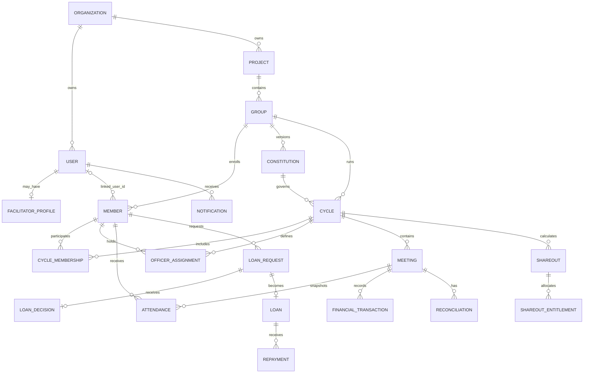

# Mobile-oriented domain data model

This is a relationship guide, not a database-column dump. API responses frequently use PostgreSQL snake_case for operational rows and curated camelCase for member self-service DTOs.

## Core concepts

| Concept / actual table | Mobile meaning |
|---|---|
| User / `users` | Login identity, organization, password hash/status, forced-change flag, optional Google Meet email |
| Role / `user_roles` | System role assignment with optional project/state scope |
| Organization / `organizations` | Top tenant boundary |
| Project / `projects` | Program container within organization |
| Facilitator / `facilitator_profiles` | Staff profile and geographic assignment attached to a User |
| Group / `vsla_groups` | VSLA; has project/location/facilitator, group status, and operation mode |
| Member / `group_members` | A person within one group; may have `linked_user_id`; not automatically a login |
| Constitution / `group_constitutions` | Versioned server rules for shares, Social Fund, loans, frequency, fines |
| Cycle / `vsla_cycles` | Time-bound operational period governed by one constitution version |
| CycleMembership / `cycle_memberships` | Effective member participation in one cycle |
| OfficerAssignment / `group_officer_assignments` | One of five positions for a member in a cycle |
| Meeting / `vsla_meetings` | OPEN/CLOSED/CANCELLED event with Physical/Virtual/Hybrid mode |
| Attendance / `meeting_attendance` | Per-meeting snapshot and attendance state |
| FinancialTransaction / `financial_transactions` | Idempotent immutable transaction header and audit reference |
| LedgerAccount/Entry | Server accounting authority; not a mobile model to calculate |
| Savings / `savings_transactions` | Purchase/reversal, shares and server-derived amount |
| Social Fund / `social_fund_transactions` | Contribution/reversal, server-derived amount |
| Fine / `fine_transactions` | Fine/reversal against a constitution rule |
| LoanRequest / `loan_requests` | PENDING → APPROVED/REJECTED/CANCELLED/DISBURSED |
| LoanDecision / `loan_decisions` | Immutable approval/rejection and actor |
| Loan / `loans` | Disbursed contract, due amounts/date, settled/voided/defaulted timestamps |
| Repayment / `loan_repayments` | Payment/reversal with server allocation to charge/principal |
| Reconciliation / `meeting_reconciliations` | Expected versus counted two-fund balances; BALANCED/VARIANCE generated status |
| ReconciliationSignature | Private PNG evidence for a reconciliation |
| ShareOut / `cycle_shareouts` | Versioned DRAFT/APPROVED/PAYOUT_IN_PROGRESS/COMPLETED/CANCELLED snapshot |
| Entitlement/Payout | Per-member server calculation and immutable payout/reversal history |
| Notification / `notifications` | In-app recipient row and read state |

## Identifiers and identity rules

All principal identifiers are UUIDs. Human-readable group/member/meeting/request/loan codes are display/reference values, not authorization identifiers. The mobile cache should key entities by UUID and keep membership IDs scoped to group/cycle.

The same User can be linked to group members in multiple groups. Self APIs resolve by the authenticated User and organization. A Member can exist without a User, and an officer assignment alone does not create Digital Access.

## Status reference

- User: ACTIVE, INACTIVE, SUSPENDED, LOCKED.
- Facilitator: ACTIVE, INACTIVE, SUSPENDED.
- Member: ACTIVE, INACTIVE, LEFT, REMOVED, DECEASED.
- Group: DRAFT, ONBOARDING, ACTIVE, SUSPENDED, CLOSED, ARCHIVED.
- Constitution: DRAFT, APPROVED, SUPERSEDED.
- Cycle: DRAFT, READY, ACTIVE, CLOSING, CLOSED, CANCELLED.
- Officer: ACTIVE, ENDED, REMOVED.
- Meeting: OPEN, CLOSED, CANCELLED.
- Attendance: UNMARKED, PRESENT, LATE, ABSENT, EXCUSED.
- Loan request: PENDING, APPROVED, REJECTED, CANCELLED, DISBURSED.
- Loan display: ACTIVE, PARTIALLY_REPAID, OVERDUE, REPAID, DEFAULTED, VOIDED.
- Share-out: DRAFT, APPROVED, PAYOUT_IN_PROGRESS, COMPLETED, CANCELLED.

Sources: migration files `database/migrations/003_organizations.sql` through `database/migrations/054_meeting_sms_notifications.sql`, plus current module repositories/services.
